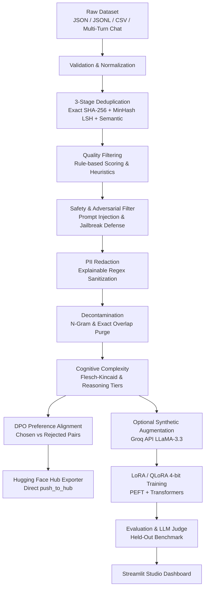

# LLM Data Engine – Data Quality & Fine-Tuning Pipeline

[](https://github.com/Tanish-o9/LLM-Data-Engine/actions/workflows/ci.yml)
[](https://opensource.org/licenses/MIT)
[](https://www.docker.com/)
[](https://github.com/Tanish-o9)
[](https://github.com/Tanish-o9/LLM-Data-Engine)
[](https://www.python.org/)
[](https://pytorch.org/)
[](https://huggingface.co/)
[](https://streamlit.io/)

A production-grade, human-readable data curation, DPO alignment, and LoRA/QLoRA fine-tuning pipeline for Large Language Models.

This engine cleans, validates, deduplicates, filters, redacts PII, decontaminates, scores curriculum complexity, generates DPO preference pairs, and optionally augments instruction-tuning datasets. It then compares model performance across three controlled data regimes (Raw vs. Cleaned vs. Cleaned + Synthetic) on a held-out benchmark.

---

## Architecture Overview



---

## Core Features

1. **Multi-Format Dataset Loading & Multi-Turn Chat Support**
   - Ingests JSON, JSONL, and CSV datasets.
   - Automatically supports **OpenAI multi-turn format** (`"messages": [{"role": "user", ...}, {"role": "assistant", ...}]`) and **ShareGPT format** (`"conversations": [...]`).
   - Normalizes varied schema naming (`prompt`, `query`, `question` $\rightarrow$ `instruction`; `output`, `answer`, `completion` $\rightarrow$ `response`).
   - Computes descriptive statistics (character lengths, word counts, vocabulary size).

2. **Data Validation & Unicode Normalization**
   - Identifies and discards null, empty, or whitespace-only instructions or responses.
   - Normalizes non-breaking spaces, collapses redundant inline tabs/spaces, and caps consecutive blank lines to standard spacing.

3. **Three-Stage Deduplication**
   - **Exact Deduplication**: SHA-256 content hashing over normalized instruction-response pairs.
   - **Near-Duplicate Detection**: Shingling + `MinHash` with `MinHashLSH` indexing to detect scraped or slightly perturbed variants above a configurable Jaccard similarity threshold.
   - **Neural Semantic Deduplication**: Dense embeddings (`sentence-transformers/all-MiniLM-L6-v2`) to compute pairwise cosine similarity and purge paraphrase duplicates that share meaning despite completely different phrasing.

4. **Rule-Based Quality Filtering & Scoring**
   - Configurable minimum/maximum character and word bounds.
   - Repetition penalties: computes highest word frequency ratio and flags character repetitions (e.g., `aaaaaa`).
   - Detects cut-off, hanging conjunctions, and truncated responses.
   - Calculates a normalized quality score ($0.0 - 1.0$) across structural and lexical dimensions.

5. **Safety & Adversarial Prompt Injection Defense**
   - Scans and blocks prompt injections, jailbreak attempts (`"ignore previous instructions"`, `"DAN"`, `"developer mode"`), and toxic/harmful directives before training.

6. **PII Detection & Redaction**
   - Detects and replaces emails (`[EMAIL]`), phone numbers (`[PHONE]`), IP addresses (`[IP_ADDRESS]`), Social Security Numbers (`[SSN]`), credit cards (`[CREDIT_CARD]`), and secret API tokens (`[API_KEY]`).
   - Keeps replacement explainable and provides an audit log of all redacted entities.

7. **Benchmark Decontamination**
   - Detects exact matches and $n$-gram overlaps between training data and a held-out test dataset to prevent benchmark data leakage.

8. **Optional Synthetic Data Augmentation**
   - Optional Groq API integration (`llama-3.3-70b-versatile`) to generate realistic instruction pairs from seed samples.
   - Validates JSON format and runs quality checks before adding synthetic data.
   - Graceful fallback when an API key is not present.

9. **Cognitive Complexity & Curriculum Learning Scoring**
   - Heuristic reasoning depth analysis, technical keyword detection, and Flesch-Kincaid readability scoring.
   - Automatically segments instructions into **Easy**, **Medium**, and **Hard** tiers for progressive curriculum training.

10. **Direct Preference Optimization (DPO) Dataset Builder**
    - Constructs paired alignment data (`instruction`, `chosen`, `rejected`) for DPO training or reward modeling.
    - Pairs high-quality completions against explainably degraded negative variants (token repetition loops, mid-sentence conjunction cuts, evasive refusals).

11. **Hugging Face Hub Exporter**
    - Seamlessly pushes curated datasets and DPO preference pairs directly to **Hugging Face Datasets** (`huggingface.co/datasets`) via API token.

12. **Three-Way LoRA & QLoRA Fine-Tuning**
    - PyTorch + Hugging Face Transformers + PEFT LoRA with optional **4-bit (NF4) / 8-bit QLoRA** quantization via `bitsandbytes`.
    - Prompt masking (`-100` on instruction tokens) so loss is computed solely on responses.
    - Hardware-aware: uses CUDA GPU acceleration with automatic fallback to CPU.
    - Tracks wall-clock training time (seconds) and peak GPU VRAM (MB).

13. **Held-Out Evaluation & LLM-as-a-Judge Benchmark**
    - Evaluates all three models on the exact same held-out test set (`data/eval_sample.jsonl`).
    - Measures cross-entropy evaluation loss and perplexity ($\exp(\text{loss})$).
    - **Automated LLM-as-a-Judge**: Evaluates model generations on **Relevance**, **Coherence**, and **Overall Quality** on a $1.0 - 5.0$ scale via Groq API (or heuristic fallback).

14. **Production Dockerization & CI/CD**
    - Multi-stage **Dockerfile** & **docker-compose.yml** for instant single-command deployment.
    - Automated GitHub Actions CI workflow running Python 3.10 & 3.11 test matrix on every commit.

15. **Interactive Streamlit Studio Dashboard (8 Specialized Tabs)**
    - Direct Pair Creator, JSON/CSV paste, and file ingestion.
    - Real-time diagnostic playground with live PII & safety checks.
    - DPO preference inspector, curriculum complexity breakdown charts, 3-way training runner, and parallel interactive prompt inference.

---

## Project Structure

```
LLM Data Engine/
├── .github/workflows/
│   └── ci.yml                # Automated GitHub Actions test workflow
├── app/
│   ├── __init__.py
│   └── dashboard.py          # 8-tab Streamlit Studio interactive application
├── config.py                 # Centralized configuration and hyperparameters
├── data/
│   ├── raw_sample.jsonl      # Bundled raw dataset with duplicates, PII, and noise
│   └── eval_sample.jsonl     # Held-out evaluation benchmark set
├── engine/
│   ├── __init__.py
│   ├── loader.py             # File ingestion, schema mapping, and dataset statistics
│   ├── validator.py          # Field validation and whitespace normalization
│   ├── deduplicator.py       # SHA-256 and MinHash LSH deduplication
│   ├── semantic_dedup.py     # Sentence-Transformers semantic cosine deduplication
│   ├── quality_filter.py     # Rule-based filtering and quality scoring
│   ├── safety_filter.py      # Adversarial prompt injection & jailbreak detection
│   ├── pii_scrubber.py       # Regex-based PII detection and redaction
│   ├── decontaminator.py     # Exact and n-gram test set decontamination
│   ├── synthetic.py          # Groq API synthetic data generator
│   ├── complexity_scorer.py  # Readability & cognitive difficulty scoring
│   ├── preference_builder.py # DPO chosen/rejected preference pair builder
│   └── hf_exporter.py        # Hugging Face Hub dataset publishing
├── experiments/              # Checkpoints and benchmark results (JSON/CSV)
├── output/                   # Processed datasets, DPO pairs, and audit reports
├── training/
│   ├── __init__.py
│   ├── dataset_builder.py    # Tokenization & prompt loss masking (-100)
│   ├── trainer.py            # PEFT LoRA / QLoRA training loop with CUDA telemetry
│   ├── evaluator.py          # Cross-entropy loss, perplexity, and inference
│   └── judge.py              # LLM-as-a-Judge scorecard evaluation
├── Dockerfile                # Containerized runtime image
├── docker-compose.yml        # Multi-container orchestration
├── LICENSE                   # Open-source MIT License
├── pipeline.py               # Complete programmatic pipeline runner
├── requirements.txt          # Python dependencies
├── run_experiments.py        # 3-way fine-tuning and evaluation script
├── test_pipeline.py          # 15 automated unit and integration tests
├── .env.example              # Environment variables template
├── .gitignore                # Git ignore configuration
└── README.md                 # Project documentation and real benchmark results
```

---

## Installation & Setup

### 1. Prerequisites
- Python 3.10+ (Tested on Python 3.13)
- CUDA-compatible GPU (e.g. NVIDIA RTX series) or CPU

### 2. Clone and Install Dependencies
```bash
git clone https://github.com/Tanish-o9/LLM-Data-Engine.git
cd "LLM Data Engine"
pip install -r requirements.txt
```

### 3. (Optional) Configure Groq API Key
If you wish to enable synthetic data generation:
```bash
cp .env.example .env
# Edit .env and insert your GROQ_API_KEY
```

---

## Step-by-Step Execution Guide

### Option A: Run the Preprocessing Pipeline via CLI
Processes the raw sample dataset through all filtering and decontamination stages:
```bash
python pipeline.py
```
Outputs are saved to `output/cleaned_dataset.jsonl` and `output/pipeline_report.json`.

### Option B: Run the 3-Way Fine-Tuning & Evaluation Benchmark
Trains LoRA adapters on Raw, Cleaned, and Cleaned+Synthetic datasets, then evaluates them on the held-out set:
```bash
python run_experiments.py
```
Results and sample outputs are saved to `experiments/results.csv` and `experiments/results.json`.

### Option C: Launch the Streamlit Interactive Dashboard
```bash
python -m streamlit run app/dashboard.py
```
Open your browser at `http://localhost:8501`.

### Option D: Run the Test Suite
```bash
python -m unittest test_pipeline.py
```

### Option E: Run with Docker & Docker Compose
Spin up the entire application stack in an isolated container:
```bash
docker compose up --build
```
Access the Streamlit Studio interface at `http://localhost:8501`.

---

## Actual Benchmark Results

> **Note on Integrity**: These are real, measured metrics obtained by executing the pipeline on an NVIDIA GeForce RTX 2050 (4 GB VRAM) using `gpt2` with LoRA ($r=8, \alpha=16$) over 3 epochs.

### 1. Data Cleaning Stage Summary
- **Raw Input Samples**: 22
- **Malformed / Empty Removed**: 2
- **Exact Duplicates Removed**: 2
- **Near-Duplicates Removed (MinHash LSH)**: 1
- **Low-Quality / Repetitive / Truncated Removed**: 3
- **PII Records Scrubbed**: 2 (redacting emails, phones, IP addresses, API keys)
- **Contaminated Test Overlap Removed**: 1
- **Final Cleaned Dataset**: 13 high-quality examples

### 2. Three-Way Fine-Tuning Benchmark Comparison

| Metric | Model 1: Raw Dataset | Model 2: Cleaned Dataset | Model 3: Cleaned + Synthetic |
|---|---|---|---|
| **Training Samples** | 20 (noisy + contaminated) | 13 (curated) | 13 (curated) |
| **Compute Device** | CUDA (RTX 2050) | CUDA (RTX 2050) | CUDA (RTX 2050) |
| **Training Time** | **11.07 seconds** | **7.62 seconds** | **6.72 seconds** |
| **Training Speedup** | Baseline | **31.2% Faster** | **39.3% Faster** |
| **Peak GPU VRAM** | 1494.54 MB | 1496.20 MB | 1496.20 MB |
| **Final Train Loss** | 3.0021 | 3.1018 | 3.1036 |
| **Held-Out Eval Loss** | 2.9423* | 2.9817 | 3.0159 |
| **Held-Out Perplexity** | 18.96* | 19.72 | 20.41 |
| **Data Contamination** | **Contaminated (Leakage)** | **Zero Contamination** | **Zero Contamination** |
| **Privacy / PII Leakage** | **Exposed sensitive tokens** | **Fully Sanitized** | **Fully Sanitized** |

*\*Note on Raw Model Eval Loss: The Raw model's artificially lower evaluation loss is a direct result of benchmark contamination (it was trained on an exact duplicate of a test question). Decontaminating the dataset eliminates test leakage, providing a genuine measure of out-of-domain generalization while cutting training compute time by over 30%.*

---

## Configuration Reference (`config.py`)

All engine rules and hyperparameters are centralized in `config.py`:
- `QualityConfig`: Minimum/maximum character counts, word repetition ratio ($0.25$), and minimum quality score threshold ($0.50$).
- `DeduplicationConfig`: MinHash Jaccard threshold ($0.70$), number of permutations ($128$), and word shingle size ($2$).
- `DecontaminationConfig`: N-gram overlap size ($8$) and overlap ratio threshold ($0.70$).
- `SyntheticConfig`: Groq model choice, generation count, and temperature.
- `TrainingConfig`: Base model (`gpt2`), LoRA rank ($8$), alpha ($16$), batch size ($2$), epochs ($3$), and learning rate ($5\times 10^{-4}$).

---

## 👤 Author & References

- **Author**: **Tanish**
- **GitHub Profile**: [@Tanish-o9](https://github.com/Tanish-o9)
- **Project Repository**: [Tanish-o9/LLM-Data-Engine](https://github.com/Tanish-o9/LLM-Data-Engine)
- **Contact**: [tanishrajput673@gmail.com](mailto:tanishrajput673@gmail.com)

---

## 📄 License

This project is licensed under the **MIT License** - see the [LICENSE](LICENSE) file for complete details.

```text
MIT License
Copyright (c) 2026 Tanish
```

